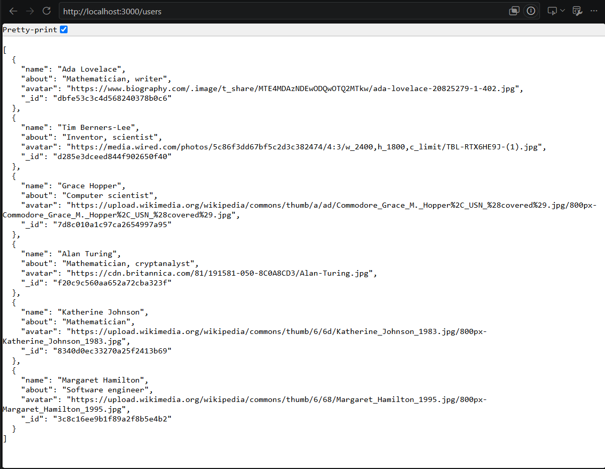
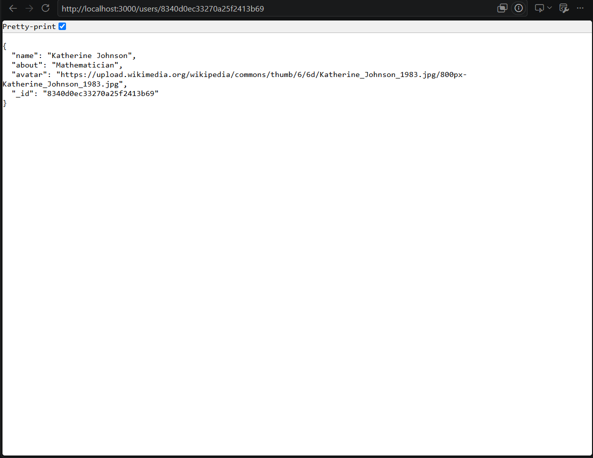
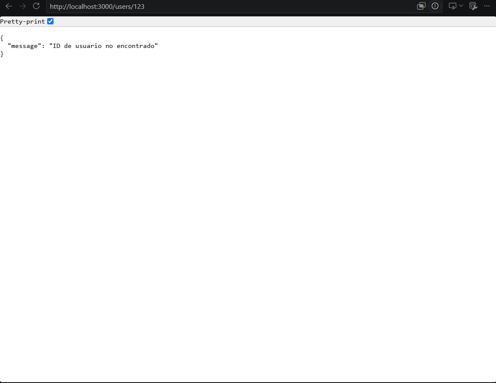

# Alrededor de los EE. UU. — API (back end)

## Descripción

Servidor back end para el proyecto **"Alrededor de los EE. UU."**, desarrollado durante el bootcamp de TripleTen (Sprint 13).

La API devuelve en formato JSON los usuarios y las tarjetas del proyecto. Por ahora los datos se leen desde archivos JSON locales. En próximos sprints se conectará a una base de datos.

## Funcionalidad

| Método | Ruta | Respuesta |
| ------ | ---- | --------- |
| GET | `/users` | Lista JSON de todos los usuarios |
| GET | `/users/:id` | JSON del usuario con ese `_id` |
| GET | `/cards` | Lista JSON de todas las tarjetas |

### Manejo de errores

| Código | Caso | Respuesta |
| ------ | ---- | --------- |
| 404 | El usuario no existe | `{ "message": "ID de usuario no encontrado" }` |
| 404 | La ruta no existe | `{ "message": "Recurso solicitado no encontrado" }` |
| 500 | Error al leer los datos u otro error interno | `{ "message": "Ha ocurrido un error en el servidor" }` |

## Tecnologías y técnicas

- **Node.js** y **Express 5**
- **TypeScript** compilado con `tsc`
- **ES Modules** (`import` / `export`)
- **tsx** para el hot reload en desarrollo
- **ESLint** (typescript-eslint) y **Prettier** para la calidad del código
- **EditorConfig** para mantener un estilo consistente
- Lectura asíncrona de archivos con `node:fs/promises`
- Rutas absolutas con `node:path` e `import.meta.dirname`
- Estructura modular: `routes/`, `controllers/` y `utils/`

## Estructura

```
web_project_around_express/
├── data/
│   ├── cards.json
│   └── users.json
├── src/
│   ├── controllers/
│   ├── routes/
│   ├── utils/
│   └── app.ts
├── .editorconfig
├── eslint.config.js
├── .gitignore
├── package.json
└── tsconfig.json
```

## Cómo ejecutarlo

```bash
npm install
npm run dev     # desarrollo con hot reload en http://localhost:3000
npm run build   # compila TypeScript a la carpeta dist/
npm run start   # ejecuta la versión compilada
npm run lint    # revisa el código con ESLint
```

## Capturas

### GET /users


### GET /users/:id


### Error 404

